# Super Clash Bros.

Un jeu de combat de plateforme en C++ inspiré de **Super Smash Bros.** : on ne vide pas une barre de vie,
on fait monter le **pourcentage de dégâts** de l'adversaire jusqu'à pouvoir l'**éjecter hors de l'écran**.

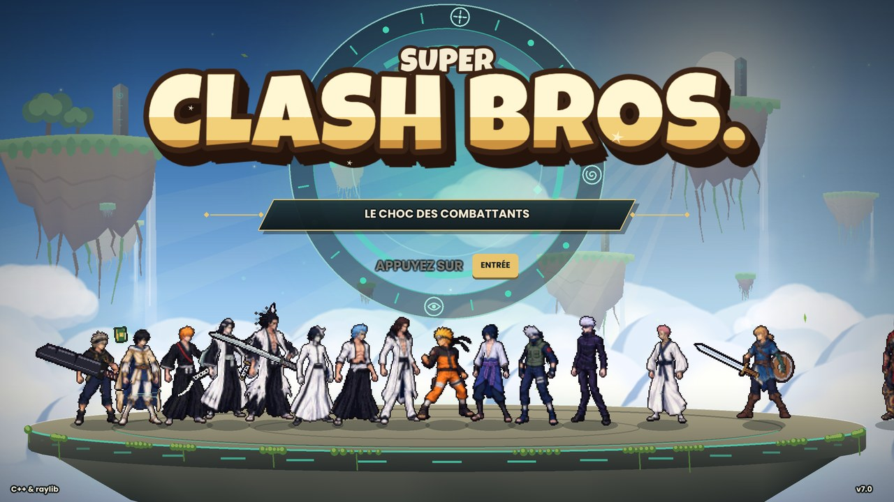

**Les 17 combattants sont faits d'après des illustrations en pixel art** : la tête, le buste et les
vêtements viennent de l'image, les bras et les jambes sont redessinés par le jeu à chaque image (en
volume, avec les motifs et les couleurs de l'illustration), voir
[Combattants illustrés](#combattants-illustrés). **Naruto, Sasuke et Kakashi sont entièrement animés image par
image** (générés avec PixelLab), **toutes les armes sont des dessins PixelLab**, et chaque combattant a une
**attaque M1 animée pour chacune de ses armes**, voir [Animations PixelLab](#animations-pixellab). En
combat, ils passent par un rendu **pixel art** (contour
sombre d'un pixel, aplats francs) ; les menus, les arènes et les effets restent lisses. Les bruitages et
l'annonceur sont enregistrés (générés avec ElevenLabs), la musique est synthétisée au lancement. Les
ressources (deux polices libres, la base de manettes SDL, les illustrations et les sons) sont intégrées
directement dans l'exécutable : il n'y a aucun fichier à installer à côté.

Les trois arènes d'origine s'inspirent de *Zelda: Tears of the Kingdom* (îles célestes, ruines Zonaï aux
runes turquoise, profondeurs éclairées par des racines lumineuses) et **huit autres viennent des animes** :
deux par série, de Las Noches à la Vallée de la Fin. Les arènes sont entièrement dessinées par le code
(aucune image ni logo repris d'un jeu ou d'un manga).

| Menu principal | Sélection des 17 combattants |
|---|---|
| 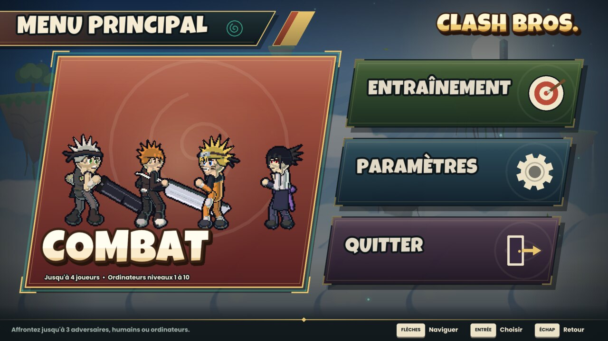 | 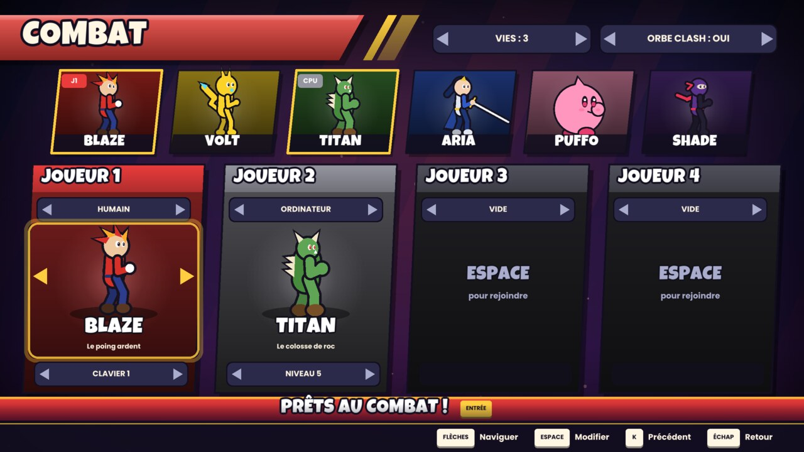 |
| **Combat : Naruto, Sasuke, Ichigo et Gojo** | **Cut-in d'ultime : Barrage Uzumaki (Naruto)** |
| 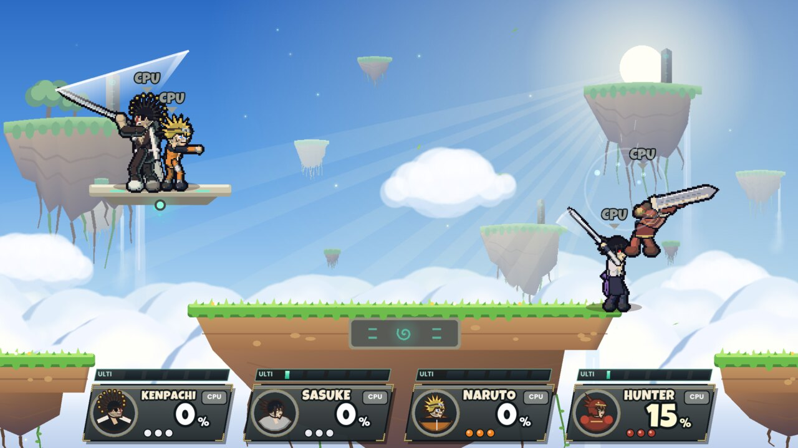 | 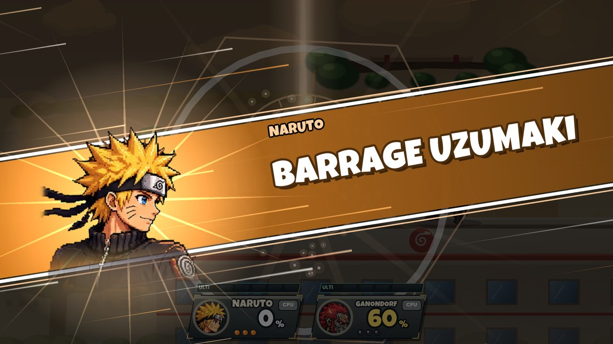 |
| **Ultime de Tensa Zangetsu : Vasto Lorde et son Cero** | **Transformation : Segunda Etapa (Ulquiorra)** |
| 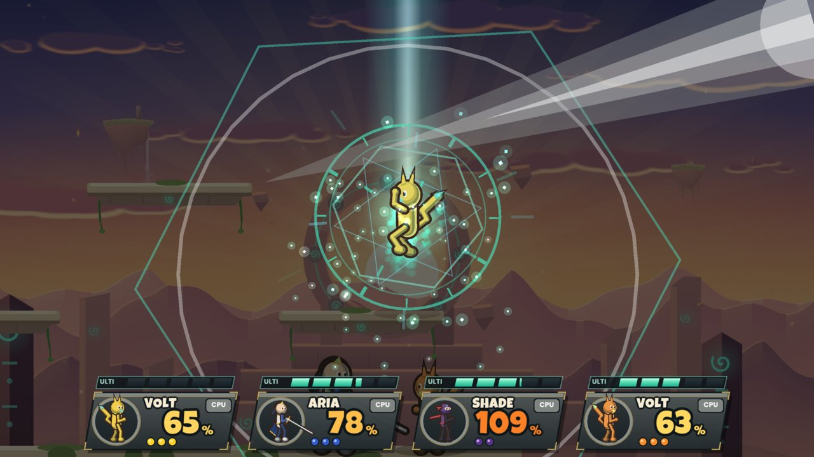 | 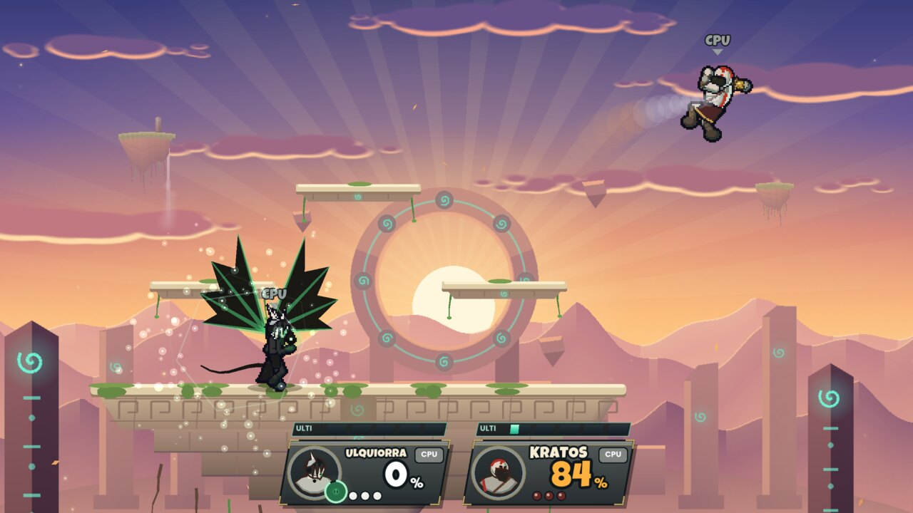 |
| **« Impact frame » façon manga** | **Entraînement** |
| 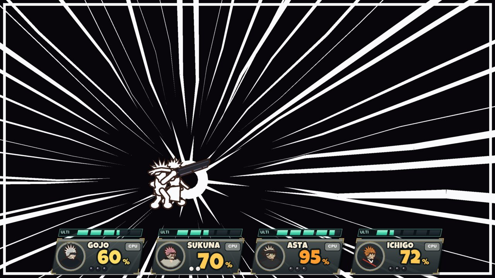 | 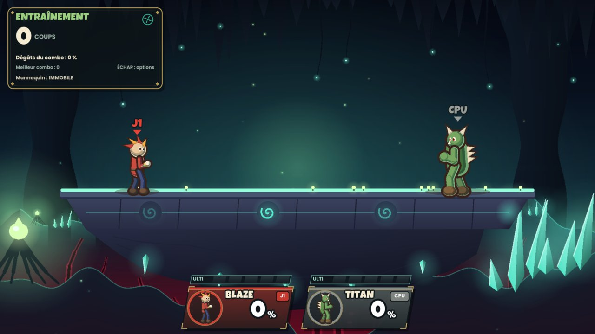 |
| **Paramètres (pixel art)** | **Résultats** |
| 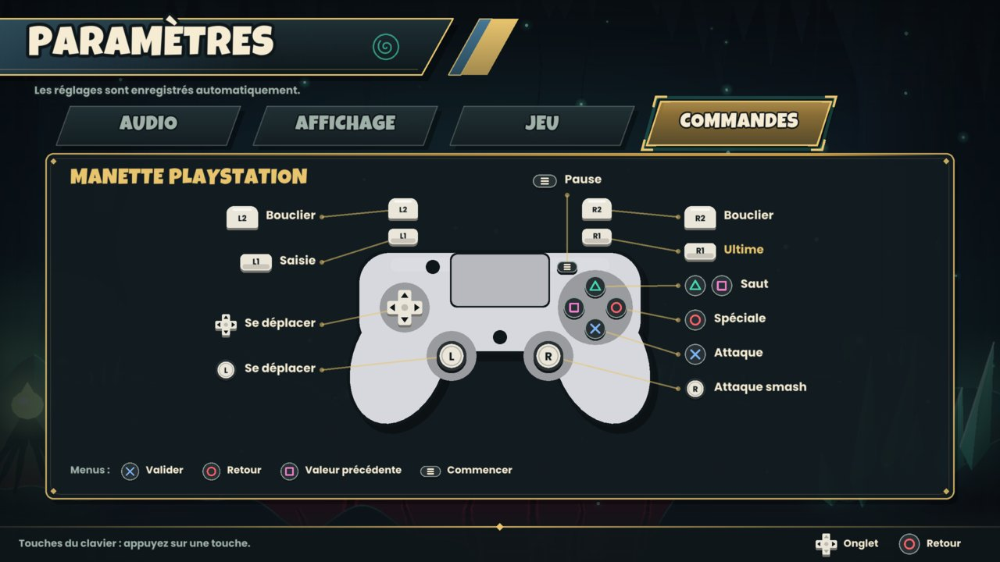 | 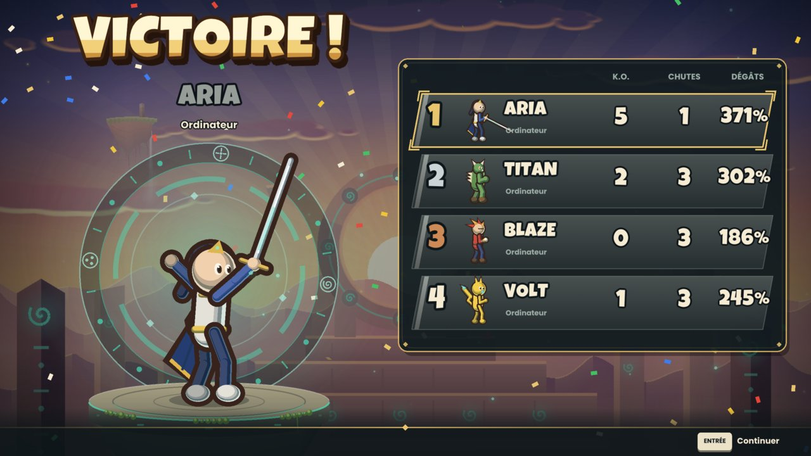 |
| **Choix de l'arène : 11 arènes** | **Vallée de la Fin : Naruto contre Sasuke sur les statues** |
| 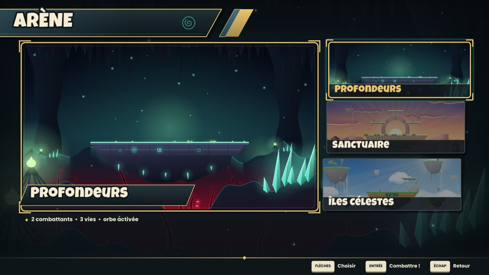 | 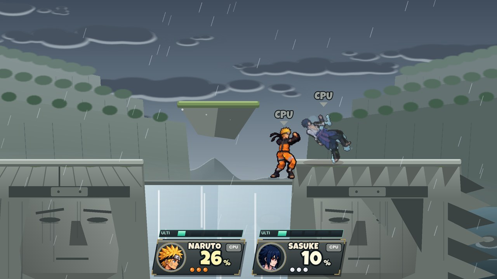 |

**Les huit arènes des animes** : Las Noches, le Seireitei, le repaire du Taureau Noir, la Tour des
Grimoires, Shibuya, le lycée Jujutsu, Konoha et la Vallée de la Fin.

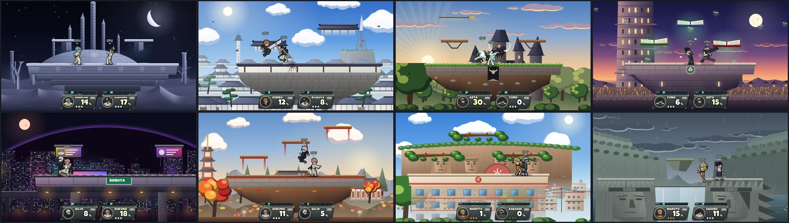

**Les animations** (planche de développement `--screen anim`) : l'illustration suit le squelette, la marche
et la course suivent le sol, Naruto court en ninja, les coups engagent tout le corps.

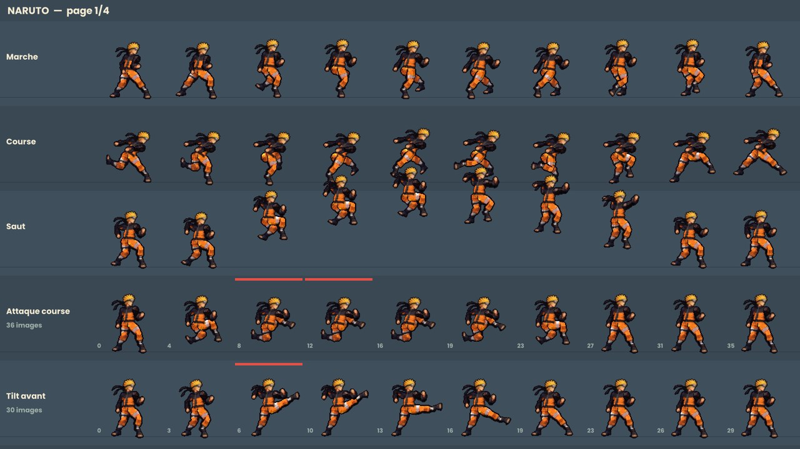

## Combattants illustrés

Chaque combattant est fait d'après une **illustration** (pixel art détaillé, en pied, tourné vers la
droite), sans la déformer :

- **La tête, le buste et les vêtements** viennent de l'image et restent rigides : ils suivent le squelette
  (penché, rotation, saut) sans jamais être étirés ni tassés. Pour les tenues amples, une **jupe** (hakama,
  kimono, robe, pans de manteau, kilt, tunique) est tenue par les hanches et suit les jambes à moitié — un
  coup de pied soulève la robe et la jambe sort dessous —, et une **cape** suit le buste ; les deux traînent
  derrière le mouvement.
- **Les bras et les jambes sont redessinés par le jeu à chaque image**, comme des volumes : leur silhouette
  (largeurs mesurées sur l'image), leurs motifs (bandages, brassards, plis, écussons) pris sur l'image dans
  un bras ou une jambe « déplié », et leur éclairage calculé par le jeu selon leur orientation, dans les
  trois tons (ombre, milieu, lumière) que l'illustration donne à chaque couleur. Un bras levé est éclairé
  comme un bras levé : plus d'effet de papier découpé, plus de membre étiré. Les poings et les chaussures
  sont des morceaux rigides de l'image, au bout des membres.
- **Les mouvements sont adaptés à chaque corps** : le jeu calcule chaque attaque sur un squelette de
  référence, puis chaque membre prend la direction et l'ouverture du membre calculé avec les longueurs de
  l'illustration. Les coudes et les genoux plient toujours dans le bon sens, les pieds restent posés au sol
  (les hanches descendent au besoin), et un membre ne se replie jamais complètement.
- Au repos, le combattant reprend la pose de l'image. Sous les membres, le buste, la jupe et la cape sont
  complétés à partir de leurs propres couleurs : un membre qui bouge ne laisse pas de trou.
- En combat, les illustrations passent par un pixel art plus fin que celui des anciens personnages (un
  pixel d'art par pixel de l'écran 1280×720), et la caméra est plus proche : les combattants sont plus
  grands et plus détaillés.

La même image sert aux portraits : carte de sélection, vignettes, cut-in d'ultime, médaillons du combat et
écran des résultats.

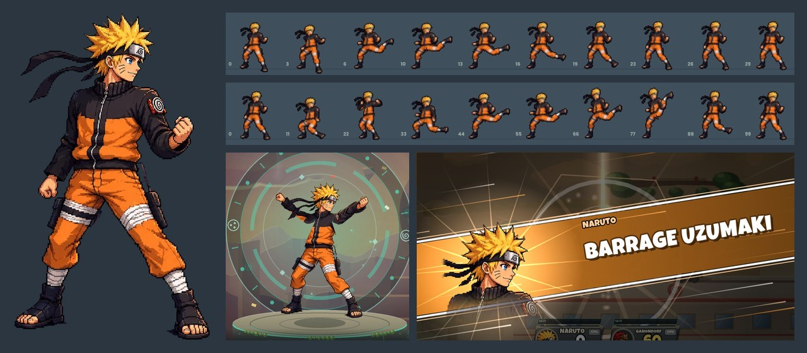

Les **17 combattants** sont illustrés. Les armes (épées, Zangetsu, lames du Chaos, arc et bouclier de Link,
grimoire de Yuno, loups de Starrk...) sont des **dessins en pixel art générés avec PixelLab** : le poing de
l'illustration se referme sur la poignée et l'image suit la lame (sa longueur, celle de la zone de coup, ne
change pas) ; les arcs se tendent entre leurs deux pointes, les boucliers et les pouvoirs (grimoires, yeux,
masques...) ont leur icône, reprise par les objets posés au sol et par le HUD. Une transformation teinte l'illustration (cape dorée de Kurama, corps
blanc du Vasto Lorde, peau rouge du Démon rouge...) en plus de son avatar (ailes, Susanoo, renard).

Pour ajouter ou remplacer un combattant (image générée avec ChatGPT : un personnage en pied, tourné vers la
droite, fond uni, bras et jambes bien séparés du corps, mains vides) :

```bash
python3 scripts/import_portrait.py image.png art/fighters/link.png   # détoure le fond uni
#   --box X0 Y0 X1 Y1 : un personnage d'une planche   --scale 2 : petite image en pixel art, agrandie au pixel près
#   --main : ôte les morceaux des voisins   --shade-min 0.85 : garde les habits de la couleur du fond
# art/fighters/link.json : les articulations repérées sur l'image, et les polygones de la jupe et de la cape
#   (voir les autres .json et scripts/rig_art.py) ; rig_art.py mesure aussi les membres (largeurs, couleurs,
#   motifs « dépliés »), les poings et les chaussures
python3 scripts/rig_art.py art/fighters/link.json --debug /tmp/link   # découpe : assets/fighters/link.png + .rig
```

puis ajouter son nom à `CLASH_FIGHTER_ART` (`CMakeLists.txt`) et à `kSources` (`src/game/fighter_art.cpp`).

### Animations PixelLab

**Naruto, Sasuke et Kakashi** sont animés **image par image** avec [PixelLab](https://www.pixellab.ai)
(`animate_image_pixminimax`) d'après leur illustration : garde, marche, course, sauts, chute, atterrissage,
bouclier, roulade, esquives, coups reçus, chute au sol et relevé, étourdissement, saisie, rebord (prise,
attente, remontée, attaque), victoire, et **tous leurs coups** (jabs, tilts, smashs, aériens, attaque en
course, chopes et projections, 4 spéciales, ultime), plus les versions avec leurs armes (mode Ermite et
manteau de Kurama de Naruto, sabre et Susanoo de Sasuke, Sharingan et Mangekyō de Kakashi). Sasuke se bat au
sabre (chokutō) : ses coups partent d'une garde sabre en main. En tout : 57 animations pour Naruto et Kakashi,
56 pour Sasuke (il n'a pas de troisième jab), plus les 34 M1 des armes et les 47 dessins d'armes.

- Les boucles (garde, chute, rebord, étourdissement...) tournent à **15 images par seconde** ; la marche et
  la course avancent avec le terrain parcouru (les pieds ne glissent pas).
- Un coup est étiré sur la durée du mouvement : la préparation jusqu'à l'image où il porte, **cette image
  reste affichée tant que la zone de coup est active**, puis le retour en garde.
- **Ramasser une arme change la M1** (le jab) : c'est une frappe de l'arme (taille, estoc, tir rapide ou
  frappe d'énergie selon l'arme), et **chaque combattant a une animation PixelLab pour chacune de ses deux
  armes** (Getsuga noir d'Ichigo, épée anti-magie d'Asta, lance de vent de Yuno, Senbonzakura de Byakuya...).
- Un état sans animation garde le rendu squelette + illustration.

```bash
# 1. la première image : le combattant au repos (avec son arme N), pieds en (100, 236), 150 px de haut
super_clash --export-pose ichigo 0 ichigo_w0.png --anchor 104 236 --pxh 130
# 2. PixelLab anime cette image (les images reviennent en f_00.png, f_01.png...) ; 3. import :
python3 scripts/import_clip.py ichigo w0_jab dossier/ --anchor 104 236 --pxh 130 --impact 3
#   --loop : boucle ; --fps 15 ; --impact N : l'image où le coup porte ; --only A-B : garde ces images ;
#   --drop PX : la première image est dessinée PX plus bas (la remontée du rebord part des mains sur le bord)
python3 scripts/import_weapon.py weapon zangetsu image.png   # une arme : weapon, icon, bow ou shield
```

Les scripts écrivent `assets/sprites/<combattant>_<animation>.png` (ou `weapon_<nom>.png`) et leur ligne dans
`assets/sprites/sheets.txt`, intégrés à la compilation. Les noms d'animations : `idle`, `walk`, `run`,
`jump`, `fall`, `land`, `shield`, `roll`, `hurt`, `knockdown`, `getup`, `ledge`, `climb`, `victory`...,
le nom du coup (`jab`, `ftilt`, `fsmash`, `nair`, `nspecial`, `ultimate`...), et `w0_`/`w1_` devant pour la
version avec l'arme 1 ou 2 (`sheetName`, `src/game/fighter_art.cpp`). `--screen anim` montre chaque
combattant image par image.

**Chaque ultime est unique** (51 en tout) : Getsuga Tenshō, Vasto Lorde, Gran Rey Cero, Cero Metralleta,
Violet imaginaire, Amaterasu, Kendō, Sanctuaire démoniaque, Shuriken du Susanoo, Barrage Uzumaki, Fouet du
Chaos, Dragon de lumière...

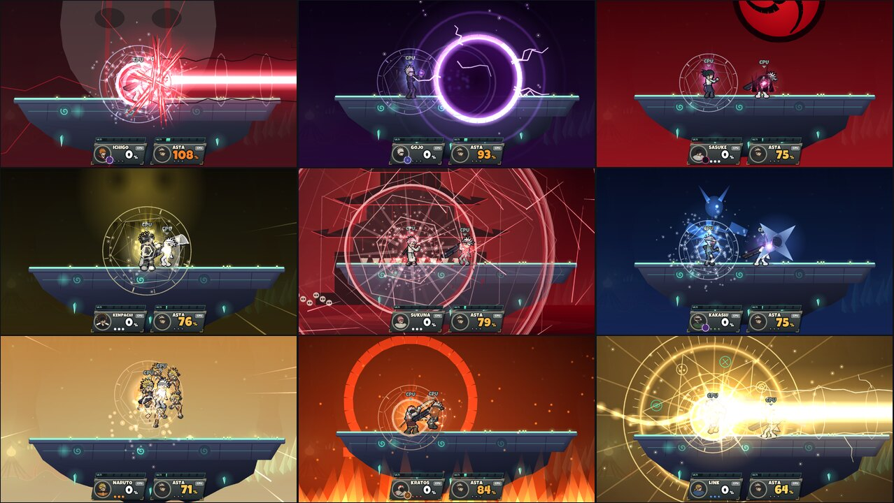

## Le jeu

- **Combat** : de 2 à 4 combattants, humains (2 sur le clavier + manettes) et/ou **ordinateurs de
  niveau 1 à 10** (le **niveau 10** joue comme un niveau 9 parfait et **frappe deux fois plus fort**),
  de 1 à 5 vies.
- **Entraînement** : vies infinies face à un **mannequin** (immobile, qui saute, qui se protège, ou
  piloté par l'ordinateur), réinitialisation des positions, **compteur de combos** et dégâts du combo,
  affichage des zones de coup. Tout se règle dans le menu pause, avec aussi :
  - **Ulti infinie** : la barre d'ulti se remplit de nouveau aussitôt (pour répéter les ultimes) ;
  - **Rester à 0 %** : les dégâts ne s'accumulent pas (chaque coup n'éjecte que de sa propre force) ;
  - **Mode combat (3 vies)** : un vrai combat de 3 vies contre le mannequin ; quand quelqu'un les a toutes
    perdues, « GAME! », puis le combat recommence (3 vies chacun, positions de départ).
  - **Arme 1/2** : les flèches (clavier, manette, ou un clic sur les flèches) choisissent l'une des deux
    armes du combattant, ENTRÉE (ou un clic au milieu) la fait tomber devant lui.
- **17 combattants** inspirés de séries cultes (hommages de fans, dessinés d'après des illustrations), chacun avec ses
  stats, 4 attaques spéciales, **2 armes à ramasser** et **3 ultimes** : un à mains nues et un par arme.
  | | Univers | Spéciales | Ultime | Arme 1 → son ultime | Arme 2 → son ultime |
  |---|---|---|---|---|---|
  | **ASTA** | Black Clover | Lame anti-magie, Météore noir, Ouragan noir, Renvoi anti-magie (renvoie les projectiles) | Black Divider | Épée pourfendeuse → Black Meteorite (monte avec sa victime et retombe comme un météore) | Épée habitante → Union démoniaque (transformation : aile et bras du diable) |
  | **YUNO** | Black Clover | Lames de vent, Tempête tranchante (tornade qui aspire), Envol de Sylphe, Tourbillon | Tempête de Zéphyr | Grimoire à quatre trèfles → Pluie de lames (sur tous les adversaires) | Lance de l'esprit → Lance de Zéphyr (aspire tout sur son passage) |
  | **ICHIGO** | Bleach | Getsuga Tenshō, Shunpo, Tsukiyomi, Cero (rayon) | Getsuga Tenshō (un croissant géant, au Shikai) | Zangetsu (Shikai) → Getsuga Jūjishō (deux Getsuga en croix) | Tensa Zangetsu (Bankai) → Vasto Lorde : il se transforme, attrape l'adversaire et lui tire un méga Cero à bout portant |
  | **BYAKUYA** | Bleach | Senbonzakura (nuée de pétales), Senka (attaque dans le dos), Shunpo céleste, Danku | Senbonzakura Kageyoshi (immobilise tout le monde dans la tempête) | Senbonzakura (Shikai) → Gōkei (une sphère de lames autour de chaque adversaire) | Kageyoshi (Bankai) → Shūkei : Hakuteiken (ailes de lumière) |
  | **KENPACHI** | Bleach | Taille du démon (à charger), Assaut sauvage (super armure), Saut du démon, Garde ouverte (contre) | Kendō : il apparaît devant l'adversaire, le frappe puis le pourfend à deux mains | Nozarashi (Shikai) → Taille de Nozarashi (fend l'arène) | Bankai → Démon rouge (transformation : peau rouge, cornes, super armure) |
  | **ULQUIORRA** | Bleach | Cero (rayon), Sonído, Sonído céleste, Bala | Cero Oscuras | Murciélago (Resurrección) → Lanza del Relámpago (javelot qui explose) | Segunda Etapa → transformation : corps noir, ailes de chauve-souris, queue |
  | **GRIMMJOW** | Bleach | Cero, Desgarrón (griffes de reiatsu), Sonído griffu, Garra de la Pantera | Gran Rey Cero | Pantera (zanpakutō) → « Kishire, Pantera » (libération : cheveux longs, oreilles, queue, griffes) | Griffes de Pantera → Desgarrón (cinq griffes géantes) |
  | **STARRK** | Bleach | Cero (rayon), Los Lobos (loups qui explosent), Sonído, Rafale de ceros | Cero Metralleta | Los Lobos (la meute) → Los Lobos (toute la meute) | Lilynette → Resurrección : Los Lobos (libération : manteau de fourrure, deux pistolets) |
  | **NARUTO** | Naruto | Rasengan (à charger), Multi-clonage (un clone court sur l'ennemi), Clone tremplin, Substitution (contre) | Barrage Uzumaki (les clones l'envoient en l'air) | Mode Ermite → Rasenshuriken | Chakra de Kurama → Bijūdama (le renard à neuf queues apparaît) |
  | **SASUKE** | Naruto | Katon : boule de feu, Chidori, Garuda, Chidori Nagashi | Kirin (le dragon de foudre tombe sur l'ennemi le plus proche) | Arc de Susanoo → Flèche d'Indra (Susanoo violet) | Mangekyō Sharingan → Amaterasu (flammes noires collées à chaque adversaire) |
  | **KAKASHI** | Naruto | Suiton : dragon aqueux, Raikiri, Shunshin, Ninken : crocs (saisie) | Raikiri | Sharingan → Kamui (un vortex sur l'ennemi le plus proche) | Mangekyō double → Shuriken du Susanoo (Susanoo bleu) |
  | **GOJO** | Jujutsu Kaisen | Rouge (explose), Bleu (attire), Téléportation, Infini (renvoie les projectiles) | Bleu : puissance maximale (un vortex sur l'ennemi le plus proche) | Technique : Violet → Violet imaginaire (le rouge et le bleu fusionnent) | Six Yeux → Extension du territoire : Sphère de l'Infini |
  | **SUKUNA** | Jujutsu Kaisen | Démantèlement, Clivage, Envol maudit, Fûga (flèche de feu qui explose) | Sanctuaire démoniaque | Kamutoke → la foudre frappe chaque adversaire | Doigt de Sukuna → Fûga (« Ouverture » : l'arène brûle) |
  | **LINK** | Zelda: Tears of the Kingdom | Arc, Bombe Zonaï, Ascension, Emprise (saisie à distance) | Dragon de lumière | Épée de légende → rafale puis rayon de l'épée | Arc de lumière → Pluie de lumière (piliers sur chaque adversaire) |
  | **GANONDORF** | Zelda: Tears of the Kingdom | Sphère de malice, Ruée du Roi Démon, Ascension maudite, Fléau de malice | Dragon démoniaque | Épée du Roi Démon → Rage du Roi Démon | Lances de malice → Piliers de malice (sous chaque adversaire) |
  | **KRATOS** | God of War | Rage spartiate, Charge du bouclier, Bond de Sparte, Parade du bouclier | Rage de Sparte (transformation : poings de feu, super armure) | Hache Léviathan → Fimbulwinter (tout le monde gèle, puis la glace éclate) | Lames du Chaos → Fouet du Chaos (les chaînes attrapent de loin, combo de fouet) |
  | **HUNTER** | Monster Hunter | Taille chargée, Coup d'épaule (super armure), Griffe-grappin, Bombe-tonneau G | Taille chargée vraie | Lame chargée → Décharge amplifiée (fioles qui explosent en chaîne) | Lancecanon → Feu du Wyvern |
- **Les armes** : de temps en temps, une arme tombe du ciel dans un rayon de lumière, au-dessus d'une
  plateforme. Chaque arme appartient à **un combattant** (son portrait flotte au-dessus) : lui seul peut
  la ramasser, **en marchant dessus**. Pendant une vingtaine de secondes (anneau autour du portrait dans
  le HUD), il frappe plus fort et plus loin, ses coups prennent l'élément de l'arme, certaines spéciales
  changent (la hache de Kratos se lance et revient, l'Épée de légende tire un rayon, Amaterasu remplace la
  boule de feu de Sasuke...), **sa M1 devient une frappe de l'arme** (animée image par image) et **son
  ultime devient celui de l'arme**. Un K.O. fait perdre l'arme. Les
  ordinateurs vont chercher les leurs. Réglage : **ARMES : OUI/NON** dans la sélection des combattants ou
  dans Paramètres → Jeu.
- **Les ultimes** : chacun a sa cinématique (cut-in avec son nom, décor plein écran : Hueco Mundo, le
  Sanctuaire démoniaque, le crâne de reiatsu de Kenpachi, un wyvern, le Mangekyō...). Certains
  **attrapent** la victime (elle est tenue pendant le combo puis éjectée), d'autres **frappent chaque
  adversaire** où qu'il soit (après un avertissement au sol), apparaissent **devant l'ennemi le plus
  proche**, ou **transforment** le combattant pour une dizaine de secondes (Rage de Sparte, Union
  démoniaque, Démon rouge, Segunda Etapa). **Les ultimes se bloquent au bouclier** : une prise ratée ne
  capture personne, mais chaque coup bloqué use le bouclier (70 % de ses dégâts), qui ressort presque vide
  d'un ultime entier. Ils ne peuvent pas être contrés. Les ordinateurs bloquent aussi, plus souvent à haut
  niveau.
- **Effets à la Dragon Ball FighterZ** : « impact frames » (l'écran passe en noir et blanc façon manga
  sur les coups signature), cut-in avec le portrait et le nom de l'ultime, rayons, ondes de choc,
  arrière-plans des extensions de territoire, gerbes d'étincelles propres à chaque élément.
- **Mécaniques à la Smash** : formule de recul de Smash (dépend du %, du poids et des dégâts), arrêt sur
  image à l'impact (*hitlag*), influence directionnelle (*DI*), petits/grands sauts, chute rapide,
  bouclier qui s'use (et se brise !), roulades, esquives au sol et en l'air, saisies + 4 projections,
  rebords (accroche, remontée, attaque, roulade, saut), retombée en culbute + *tech*, chute libre après
  la remontée, attaques smash à charger, super armure, contres, projectiles, plateformes traversables
  et mobiles. Les zones de coup des épées suivent la lame.
- **La barre d'ulti** : sous forme de cellules d'énergie Zonaï au-dessus de chaque carte de dégâts, elle
  se remplit **en frappant** (0,45 point par % infligé) **et en prenant des coups** (0,35 point par %
  reçu). Pleine, le combattant s'entoure d'une aura de son élément, la carte affiche « ULTI PRÊTE ! » avec
  le bouton à presser, et la touche **Ultime** déclenche l'ultime. Les ordinateurs s'en servent aussi
  (de loin pour les ultimes qui visent, face à la cible pour les rayons).
- **L'Orbe Clash** (l'équivalent de la Smash Ball) : elle apparaît de temps en temps et flotte au-dessus
  de l'arène. Celui qui la brise **remplit d'un coup sa barre d'ulti**.
- **11 arènes**, chacune avec sa disposition :
  - *Zelda* : **Profondeurs** (abîme, racines lumineuses et cristaux), **Sanctuaire** (temple Zonaï en
    ruine au soleil couchant) et **Îles Célestes** (îles flottantes, cascades, plateforme mobile) ;
  - *Bleach* : **Las Noches** (le palais des Espada sous la lune du Hueco Mundo, du sable qui coule des
    corniches) et le **Seireitei** (murs blancs et toits de tuiles, la tour Senzaikyū, le Sōkyoku,
    papillons de l'enfer) ;
  - *Black Clover* : le **repaire du Taureau Noir** (un balai magique fait des allers-retours) et la
    **Tour des Grimoires** au crépuscule (des grimoires flottent en montant et descendant) ;
  - *Jujutsu Kaisen* : **Shibuya** sous le voile (néons, écran géant, un train passe sur le viaduc) et
    le **lycée Jujutsu** en automne (pagode, torii, érables, passerelles en escalier) ;
  - *Naruto* : **Konoha** (le mont des Hokage, la tour du Hokage, des branches comme plateformes) et la
    **Vallée de la Fin** sous la pluie (on se bat sur les têtes des statues de Hashirama et Madara, la
    cascade entre les deux).
- **Animations** : la marche et la course sont réglées sur la distance parcourue (le pied posé ne glisse
  pas), avec une vraie foulée, le talon qui remonte, le genou qui monte, un rebond à chaque pas et les
  bras qui balancent ; Naruto, Sasuke et Kakashi courent en ninja (bras en arrière), les colosses
  chargent comme des taureaux. Les coups engagent tout le corps : épaules et hanches qui tournent, pas en
  avant, poing libre ramené à la hanche, bras écartés pour l'équilibre des coups de pied ; les smashs
  s'arment beaucoup plus loin. Les ultimes commencent par une concentration d'énergie (jambes écartées,
  poings aux hanches, cri), et la caméra se resserre sur l'ultime et ses victimes. Une victime éjectée
  se plie d'abord autour du coup avant de tournoyer. Et toujours : transitions fluides entre les poses,
  postures propres aux spéciales, traînées des attaques, étirements et tassements, capes et cheveux qui
  suivent le mouvement, respiration et clignements d'yeux.
- Effets : **compteur de combos** au-dessus de la victime (« 5 COUPS ! » et les dégâts du combo), la
  victime s'illumine de l'élément du coup (feu, foudre, ténèbres...), les coups lourds **fissurent le
  sol** et soulèvent des débris, les éjections mortelles crépitent d'éclairs ; étincelles, traînées
  d'éjection, rayon de K.O., tremblement d'écran, bulles quand un combattant est hors-champ, caméra
  dynamique, compte à rebours, « GAME ! », écran de résultats, transitions animées entre les écrans.

## Paramètres

Le menu **Paramètres** a quatre onglets, et tout est enregistré automatiquement dans le fichier
`super_clash.cfg`, à côté de l'exécutable :

- **Audio** : volume général, musique, effets sonores (et un bouton pour tester).
- **Affichage** : plein écran, qualité graphique (*Haute* = contours lissés, rendu en double
  résolution ; *Normale* pour les petites machines), secousses de l'écran, noms au-dessus des joueurs,
  compteur d'images (FPS), zones de coup, **personnages en pixel art** (OUI par défaut ; NON = dessin
  lisse).
- **Jeu** : nombre de vies, Orbe Clash, armes, niveau des ordinateurs par défaut (1 à 10), tout réinitialiser.
- **Commandes** : **toutes les touches des deux claviers sont réassignables** (une touche déjà prise
  est échangée). Quand une manette est utilisée, l'onglet montre **ses boutons, réassignables eux
  aussi** : deux boutons par action (saut, attaque, spéciale, bouclier, saisie, attaque smash, ultime),
  `A` sur une case puis le bouton voulu, `X` pour vider une case. Se déplacer (stick gauche / croix),
  l'attaque smash au stick droit et `Start` (pause) ne changent pas, pas plus que les boutons des menus.

Si l'ordinateur n'arrive pas à suivre en qualité *Haute*, le jeu passe tout seul en *Normale*.

## Contrôles

Touches et boutons par défaut (modifiables dans **Paramètres → Commandes**) :

| Action | Clavier 1 | Clavier 2 | Manette (Xbox / PlayStation / Switch) |
|---|---|---|---|
| Se déplacer / viser | `W` `A` `S` `D` | Flèches | Stick gauche / croix |
| Sauter | `Espace`, ou `W` (Haut) | `,` ou `Pavé 0`, ou `Flèche haut` | `X` / `Y` (□ / △), ou le stick vers le haut |
| Attaque | `J` | `.` ou `Pavé 1` | bouton de droite : `A` sur Switch (`B` Xbox, ○) |
| Spéciale | `K` | `/` ou `Pavé 2` | bouton du bas : `B` sur Switch (`A` Xbox, ✕) |
| Bouclier / esquive | `L` | `Maj droite` ou `Pavé 3` | `ZL` / `ZR` (`LT` / `RT`, `L2` / `R2`) |
| Saisie | `I` (ou bouclier + attaque) | `Ctrl droit` ou `Pavé 5` | `L` / `R` (`LB` / `RB`, `L1` / `R1`) |
| Attaque smash | `O` (+ direction) | `;` ou `Pavé 4` | Stick droit |
| **Ultime** (barre pleine) | `U`, ou Spéciale | `'` ou `Pavé 6`, ou Spéciale | Spéciale (`B` sur Switch), ou `−` / `Back` |
| Pause | `Échap` / `P` | `Échap` / `P` | `Start` (`Options`, `+`) |

La manette reprend **les touches de Super Smash Bros. Ultimate**, à la même place : attaque à droite, spéciale en
bas, saut en haut et à gauche, saisie sur les gâchettes hautes, bouclier sur les gâchettes basses, smash au stick
droit. Comme le Final Smash, **l'ultime part avec la spéciale** (sans direction) quand la barre est pleine.

**Haut saute, et attaque vers le haut** (comme Smash Bros., réglage « Saut avec Haut » dans Paramètres > Jeu) :
pousser le stick vers le haut, ou appuyer sur la touche Haut, fait sauter. Pendant l'élan du saut (les quelques
images avant de quitter le sol), une attaque transforme le saut en coup vers le haut :

| | Manette | Clavier |
|---|---|---|
| Saut | stick vers le haut (vite) | Haut seul |
| Smash haut | stick vers le haut + Attaque ensemble | Haut + Attaque **en même temps** (ou Haut + Smash) |
| Tilt haut | stick poussé doucement vers le haut + Attaque | Haut, **puis** Attaque juste après |
| Spéciale haut | stick vers le haut + Spéciale | Haut + Spéciale |
| Aérienne haute | en l'air : haut + Attaque | en l'air : Haut + Attaque |

Le saut fonctionne aussi depuis le bouclier (pour un smash haut ou une spéciale haut en sortie de bouclier).

**Combat en équipes (2 contre 2)** : sur l'écran des combattants, la règle en haut à droite passe de « SOLO »
à « 2 CONTRE 2 ». Chaque carte porte alors une pastille **ROUGE** ou **BLEUE** (joueurs 1-2 contre 3-4 au
départ) : appuyez dessus pour changer de camp. Les coéquipiers ne se blessent pas (ni coups, ni projectiles, ni
ultimes), les ordinateurs visent l'autre équipe, et la dernière équipe encore en vie gagne ; les étiquettes, les
cartes et les résultats prennent la couleur de l'équipe. Ça marche aussi en 2 contre 1 ou 3 contre 1.

**Combos de touches** (clavier et manette) :

| Combinaison | Effet |
|---|---|
| Attaque + Spéciale ensemble | attaque smash (dans la direction tenue, sinon vers l'avant) ; en l'air, une aérienne |
| Bouclier + Attaque | saisie |
| Bas, Bas-avant, Avant + Attaque (quart de cercle) | smash avant **à pleine puissance**, sans le charger (l'écran flashe) |
| Bas, Haut + Attaque | smash haut à pleine puissance |
| Spéciale avec la barre d'ulti pleine | ultime |

**Paramètres > Commandes** : « Tout réinitialiser » remet d'un coup les touches des deux claviers et les boutons
de la manette par défaut (« Réinitialiser » ne remet qu'un clavier, ou que la manette).

Les touches correspondent à des **positions** sur le clavier (celles d'un clavier QWERTY) : sur un
clavier AZERTY, le joueur 1 se déplace donc avec `Z` `Q` `S` `D`, et le joueur 2 utilise `;` (saut),
`:` (attaque), `!` (spéciale), `M` (smash) et `ù` (ultime). L'écran **Commandes** affiche le nom réel
des touches de votre clavier.

Les boutons de la manette sont désignés par leur **position** : sur une manette Switch, l'attaque est le
bouton de droite (`A`) et la spéciale celui du bas (`B`), comme dans Smash ; sur une manette Xbox, ce sont `B`
et `A`. Sur une manette **sans gâchettes** (style Super Nintendo), le bouclier passe sur `R`/`RB` et la saisie
sur `L`/`LB` ; l'écran affiche alors ces boutons-là.

**Manettes** : branchez-les quand vous voulez, elles sont reconnues automatiquement (Xbox, PlayStation,
Switch Pro, 8BitDo, Logitech... grâce à la base [SDL_GameControllerDB](https://github.com/mdqinc/SDL_GameControllerDB)
intégrée au jeu, licence zlib : `assets/gamecontrollerdb-LICENSE.txt`). Le pavé tactile et les capteurs de
mouvement des manettes PlayStation, que Linux présente comme des manettes à part, sont ignorés.
- La manette (ou le clavier) qui ouvre **Combat** ou **Entraînement** devient celle du joueur 1.
- La **sélection des combattants** est faite comme celle des jeux de combat d'anime : un grand « VS » au
  milieu, les combattants en grand face à face (J1 et J3 à gauche contre J2 et J4 à droite ; en équipes, rouges
  contre bleus), une plaque sous chacun (nom, humain / ordinateur, clavier / manette ou niveau), la case
  **« ? »** au centre et tous les combattants en grille en bas : le visage de chacun en gros plan sur la
  couleur de son univers (vert Black Clover, bleu Bleach, orange Naruto, violet Jujutsu Kaisen, turquoise
  Zelda, rouge God of War, or Monster Hunter), son nom en dessous. La **lumière de chaque côté** prend la
  couleur de l'aura du combattant choisi par le premier joueur de ce côté : J1 à gauche (orange pour Naruto),
  J2 à droite (violet pour Sasuke) ; J3 et J4 ne la changent pas. En équipes, c'est le premier joueur de
  chaque équipe, et « ? » fait défiler toutes les couleurs. **Chaque joueur a son propre curseur**
  (étiquette J1, J2... de sa couleur) : gauche / droite change son combattant ; une ligne plus bas (la
  plaque), son clavier ou sa manette, ou le niveau d'un ordinateur ; sur le type (HUMAIN / ORDINATEUR),
  gauche / droite passe à un autre joueur. La case **« ? »** tire un combattant au sort au début du combat,
  et la carte **« ? »** de l'écran des arènes une arène. Le clavier 2 rejoint la partie avec sa touche
  d'attaque (`.`).
- Dans la sélection des combattants, une autre manette **rejoint la partie en appuyant sur `A` (ou
  `Start`)** : elle prend la première place libre (ou celle d'un ordinateur). On peut toujours choisir
  l'appareil de chaque joueur à la main, en bas de sa carte (« MANETTE 2 », avec le modèle reconnu).
- Si la manette d'un joueur se débranche pendant un combat, le jeu se met en **pause** ; rebranchée,
  elle retrouve son numéro et son joueur.
- Dès qu'une manette est branchée ou utilisée, l'écran montre **ses boutons** (symboles Xbox,
  PlayStation ou Nintendo) ; une touche du clavier fait revenir les touches du clavier. L'onglet
  **Commandes** montre alors le schéma de la manette avec chaque action.

Combinaisons :
- **Attaque smash** : direction + attaque *en même temps* (ou la touche smash). Maintenir pour charger.
- **Attaques normales (tilts)** : maintenir la direction un court instant, *puis* attaquer.
- **Bouger en attaquant** : pendant les coups au sol (enchaînement de coups simples, tilts), gauche / droite
  fait avancer ou reculer le combattant un peu (à peu près la moitié de sa marche), sans le retourner ; il
  s'arrête au bord de la plateforme au lieu de tomber.
- **Attaque en course** : courir puis attaquer.
- **Aériennes** : attaque + direction en l'air (avant, arrière, haut, bas, neutre).
- **Spéciales** : spéciale + direction (neutre, côté, haut = remontée, bas).
- **Petit saut** : appui bref sur saut. **Chute rapide** : bas pendant la descente.
- **Bouclier + gauche/droite** = roulade, **bouclier + bas** = esquive, **bouclier en l'air** = esquive aérienne.
- **Saisie puis direction** = projection, **saisie puis attaque** = coup de genou.
- **Bas sur une plateforme fine** = la traverser. Au **rebord** : vers la scène pour remonter, saut,
  attaque ou bouclier.

Dans les menus : flèches (ou `WASD`), `Entrée` pour valider, `Échap` pour revenir, `Espace`/`J` pour
modifier une valeur et `K` pour revenir à la valeur précédente. À la manette : stick gauche ou croix,
`A` pour valider ou modifier, `B` pour revenir, `X` pour la valeur précédente, `Start` pour lancer le
combat. La souris marche partout (clic gauche et clic droit). `F11` : plein écran. `F1` en combat :
afficher les zones de coup. Pour voir les boutons d'une manette sans en avoir une :
`super_clash --pad-glyphs xbox` (ou `ps`, `switch`).

## Jouer sans compiler

**Télécharger la dernière version** (toutes les versions sont sur la page
[Releases](https://github.com/grahamyoan9710-tech/test-claude/releases)) :

- **Linux 64 bits** :
  [SuperClashBros-linux-x64.tar.gz](https://github.com/grahamyoan9710-tech/test-claude/releases/latest/download/SuperClashBros-linux-x64.tar.gz)
  (Ubuntu 24.04 ou plus récent) : décompresser, puis dans un terminal ouvert dans le dossier : `./super_clash`.
- **Windows 64 bits** :
  [SuperClashBros-windows-x64.zip](https://github.com/grahamyoan9710-tech/test-claude/releases/latest/download/SuperClashBros-windows-x64.zip)
  : décompresser, puis double-cliquer sur `super_clash.exe` (si Windows affiche « Windows a protégé votre
  ordinateur » : « Informations complémentaires » puis « Exécuter quand même »).

Une version se publie toute seule quand son numéro (le « vX.Y » de `src/game/screen_title.cpp`) arrive sur la
branche de travail : GitHub Actions (`.github/workflows/release.yml`) lance les tests, fabrique les deux archives
avec `scripts/package_release.sh` et les met dans la release vX.Y, avec les notes de `packaging/NOUVEAUTES.md`. Une
version déjà publiée n'est pas refaite ; un tag `vX.Y` poussé, ou le workflow lancé à la main, la refait. Le même script fabrique les archives en local,
dans `dist/` (`SuperClashBros-9.1-linux-x64.tar.gz` et `SuperClashBros-9.1-windows-x64.zip`).

Chaque archive contient un seul exécutable autonome (polices, sons et icône intégrés), une notice
`LISEZ-MOI.txt` et les licences des polices. La version Windows est compilée depuis Linux avec MinGW-w64
(`cmake/mingw-w64.cmake`).

## Compilation

Prérequis : un compilateur C++17 et CMake ≥ 3.16. [raylib](https://www.raylib.com/) 5.5 est téléchargée
automatiquement depuis GitHub par CMake si elle n'est pas installée.

**Linux** (Debian/Ubuntu) :
```bash
sudo apt install build-essential cmake git libx11-dev libxrandr-dev libxinerama-dev \
                 libxcursor-dev libxi-dev libgl1-mesa-dev libasound2-dev
cmake -S . -B build -DCMAKE_BUILD_TYPE=Release
cmake --build build -j
./build/super_clash
```

**macOS** : `xcode-select --install` et `brew install cmake`, puis les trois mêmes commandes `cmake`.

**Windows** : avec Visual Studio 2022 (« Développement Desktop en C++ »), dans l'invite de commandes
développeur :
```bat
cmake -S . -B build
cmake --build build --config Release
build\Release\super_clash.exe
```

**Sans accès à GitHub depuis le terminal** (réseau d'école ou d'entreprise) : téléchargez raylib
avec le navigateur (`https://github.com/raysan5/raylib/archive/refs/tags/5.5.zip`), décompressez-la,
puis indiquez son dossier à CMake :
```bash
cmake -S . -B build -DCMAKE_BUILD_TYPE=Release -DFETCHCONTENT_SOURCE_DIR_RAYLIB=/chemin/vers/raylib-5.5
```

### Options de lancement

```
super_clash --demo            # match de démonstration entre 4 ordinateurs
super_clash --demo --fighters 7,8   # ... avec ces combattants (numéros dans la grille, de 0 à 16)
super_clash --demo --fighters 6,4 --ult 1   # le premier déclenche son ultime (-1 mains nues, 0 ou 1 : arme)
super_clash --teams --demo --fighters 8,9,2,13   # combat en équipes : les deux premiers contre les deux autres
super_clash --screen menu     # démarrer sur un écran : menu, settings, css, stage, training...
super_clash --export-pose naruto -1 naruto.png   # le combattant au repos sur une image 256x256 transparente (première image d'une animation PixelLab ; 0 ou 1 : avec son arme)
super_clash --screen menu --palette 2   # essayer une palette des menus : 0 actuelle, 1 Brasier, 2 Néon, 3 Shōnen, 4 Électrique, 5 Pop
super_clash --screen training --fighters 8,9   # entraînement : Naruto (clavier 1) contre Sasuke en cible
super_clash --screen poses --tab 0   # planche de poses : chaque perso au repos, avec ses armes, en marche, en course, en saut (pages 0 à 3)
super_clash --screen anim --tab 48   # pellicules d'animation : combattant N/6, page N%6 (allures, jabs, smashs, spéciales et ultime, M1 des armes, rebord et chopes)
super_clash --stage 10        # arène par défaut (0 à 10, dans l'ordre de l'écran de choix)
super_clash --demo --record 300 480 2 dossier   # enregistre une image sur 2 de 300 à 480 (pour des GIF)
super_clash --debug           # zones de coup visibles
super_clash --export-audio d  # écrit tous les sons et musiques en .wav dans le dossier d
```

## Tests

La simulation est indépendante du rendu : elle se compile seule et se teste sans écran.

```bash
cmake -S . -B build-core -DCLASH_BUILD_GAME=OFF
cmake --build build-core -j
./build-core/sim_test
```

Les tests vérifient la formule de recul, les coups, les K.O., chaque commande clavier (petit/grand saut,
smash/tilt, aériennes, bouclier, roulade, saisie, rebord, plateformes), la barre d'ulti, l'Orbe Clash et
l'attaque finale,
le mode entraînement, la remontée de chaque personnage depuis le vide (des deux côtés de chaque arène et
depuis le trou de la Vallée de la Fin), des dizaines de matchs complets entre ordinateurs sur chacune des
11 arènes, l'équilibrage et le déterminisme. Les **51 attaques finales** (une de base et une par
arme pour chaque combattant) sont lancées une par une : chacune doit infliger des dégâts, relâcher l'adversaire qu'elle a
attrapé et l'éjecter à 130 % (les transformations comme la Rage de Spartiate ou le Démon rouge doivent
s'activer), puis contre un bouclier : aucune capture, aucun dégât tant que le bouclier tient. Un coup porté
par l'ordinateur de niveau 10 doit faire exactement deux fois les dégâts du même coup au niveau 9.

On peut ne lancer qu'une partie des tests : `./build-core/sim_test ults`, `cpu10`, `weapons`,
`recovery`, `balance`, `det`…

## Architecture

```
src/core/   simulation pure (aucune dépendance)
  moves.hpp            données : hitboxes, projectiles, attaques, personnages
  roster*.cpp          les 17 combattants, leurs attaques et leurs armes
  roster_kit.hpp       outils communs pour écrire les attaques (saisies, éjections, ciné d'ulti)
  roster_ultimates.cpp les 51 attaques finales et les transformations
  weapons.cpp          armes qui tombent du ciel, ramassage, durée
  stage.cpp            les 11 arènes (disposition, zones de K.O.)
  fighter_update.cpp   machine à états des combattants (contrôles)
  fighter_physics.cpp  déplacements, collisions, atterrissages, rebords
  combat.cpp           détection des coups, recul, bouclier, contres, saisies, projectiles
  match.cpp            déroulement du match, K.O., réapparition, barre d'ulti, Orbe Clash, entraînement
  ai.cpp               ordinateur (niveaux 1 à 10) et mannequins
src/game/   interface raylib
  app.cpp              boucle principale, rendu suréchantillonné, transitions
  screen_title.cpp     écran titre et menu principal
  screen_settings.cpp  paramètres (audio, affichage, jeu, touches)
  menus.cpp            sélection des combattants et de l'arène
  screen_results.cpp   résultats
  match_screen.cpp     combat, pause, outils d'entraînement
  controls.cpp         claviers, manettes (numérotation, branchement à chaud), navigation des menus
  ui.cpp               kit d'interface : fonds animés, tuiles, curseurs, titres en relief, boutons de manette
  settings.cpp         paramètres enregistrés et noms des touches
  fonts.cpp            polices intégrées
  pixel.cpp            rendu pixel art des personnages (petite texture, contour, palette réduite)
  render_body.cpp      dessin des personnages (squelette + IK)
  fighter_art.cpp      combattants illustrés : tête, buste et vêtements de l'image, membres redessinés en volume ;
                       animations image par image (sheets.txt)
  render_weapons.cpp   dessin des armes (images PixelLab, en main et posées au sol)
  export_pose.cpp      --export-pose : un combattant au repos sur une image transparente
  render_items.cpp     armes posées sur l'arène
  render_vfx.cpp       rayons et arrière-plans des ultimes
  render_ult.cpp       cinématiques propres à chaque attaque finale, avatars des transformations
  render_fighter.cpp   poses : chaque attaque anime le membre qui porte la hitbox
  render_world.cpp     décors des arènes Zelda, plateformes, projectiles, aperçus et vignettes des arènes
  render_stages.cpp    les huit arènes des animes (ciel, couches en parallaxe, plateformes, pluie...)
  paint.cpp            outils de peinture des décors (dégradés, nuages, montagnes, couches précalculées)
  screen_poses.cpp     planches de développement (poses, pellicules d'animation)
  render_hud.cpp       pourcentages, vies, barre d'ulti, bulles hors-champ, compte à rebours
  fx.cpp               particules, rayons de K.O., tremblements, sons
  audio.cpp            synthèse des sons et de la musique
assets/fonts/          polices (intégrées à la compilation par cmake/embed.cmake)
assets/gamecontrollerdb.txt  base des manettes SDL (intégrée elle aussi)
assets/fighters/       illustrations découpées (morceaux + articulations), intégrées à la compilation
assets/sprites/        animations et armes PixelLab (planches d'images et sheets.txt), intégrées elles aussi
assets/audio/          bruitages, annonceur et musiques (.mp3), intégrés eux aussi
art/fighters/          illustrations détourées et leurs articulations (sources de assets/fighters)
scripts/               import_portrait.py (détourage), rig_art.py (découpe), import_clip.py et
                       import_weapon.py (animations et armes PixelLab), import_sheet.py (planches
                       d'images), package_release.sh (archives)
tests/sim_test.cpp     tests sans écran
```

La simulation tourne à 60 images/seconde à pas fixe et est entièrement déterministe.

## Crédits

- Police **Luckiest Guy** par Astigmatic — licence Apache 2.0 (`assets/fonts/LuckiestGuy-LICENSE.txt`).
- Police **Poppins** par Indian Type Foundry — licence SIL Open Font License 1.1 (`assets/fonts/Poppins-OFL.txt`).
- Base de manettes **SDL_GameControllerDB** — licence zlib (`assets/gamecontrollerdb-LICENSE.txt`).
- Direction artistique inspirée de *The Legend of Zelda: Tears of the Kingdom* (Nintendo) ; aucun élément
  du jeu n'est repris.
- Illustrations des **17 combattants** (`art/fighters/`) : générées par l'auteur du projet avec ChatGPT,
  détourées et découpées par `scripts/`.
- Animations de Naruto, Sasuke et Kakashi, attaques M1 des armes et dessins des armes (`assets/sprites/`) :
  générés avec PixelLab d'après les illustrations.
- Bruitages et annonceur (`assets/audio/`) : générés avec ElevenLabs. Un son sans fichier est synthétisé par
  le jeu ; les musiques `music_menu.mp3` et `music_<monde>.mp3` (naruto, bleach, blackclover, jjk, zelda)
  remplacent le thème synthétisé dès qu'elles sont dans le dossier.
- **Projet de fan, non officiel et non commercial.** Les combattants rendent hommage à *Black Clover*
  (Yūki Tabata / Shūeisha), *Bleach* (Tite Kubo / Shūeisha), *The Legend of Zelda: Tears of the Kingdom*
  (Nintendo), *God of War* (Santa Monica Studio / Sony Interactive Entertainment), *Jujutsu Kaisen*
  (Gege Akutami / Shūeisha), *Naruto* (Masashi Kishimoto / Shūeisha) et *Monster Hunter* (Capcom) ; ces noms et personnages appartiennent à leurs ayants droit. Les
  arènes, les effets et les sons sont faits par le code ; aucune image, aucun son et aucun modèle tiré de ces
  œuvres n'est utilisé.
