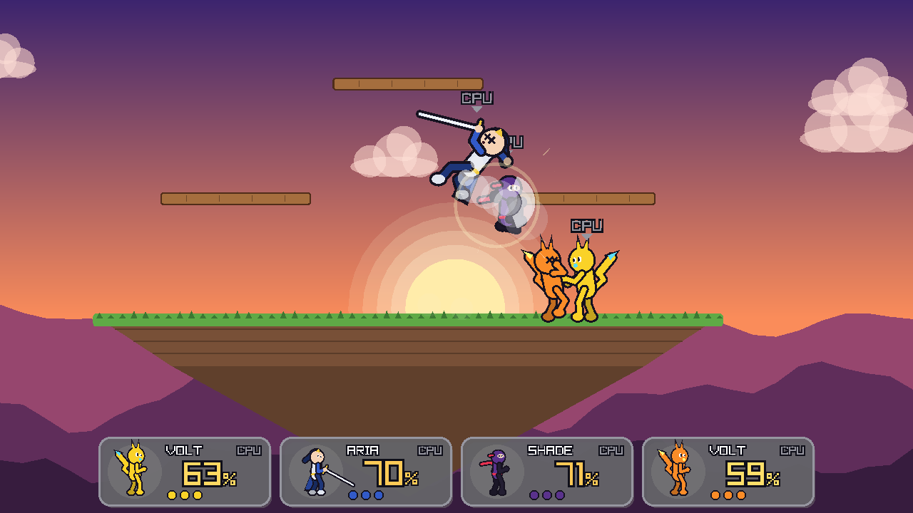
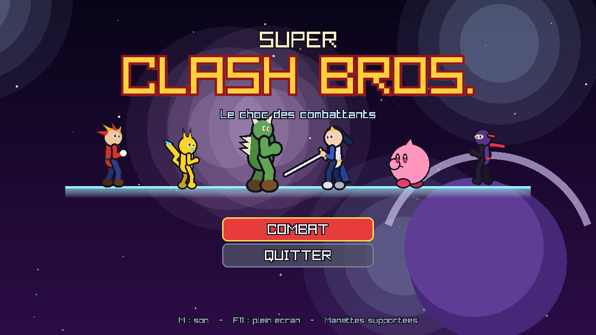
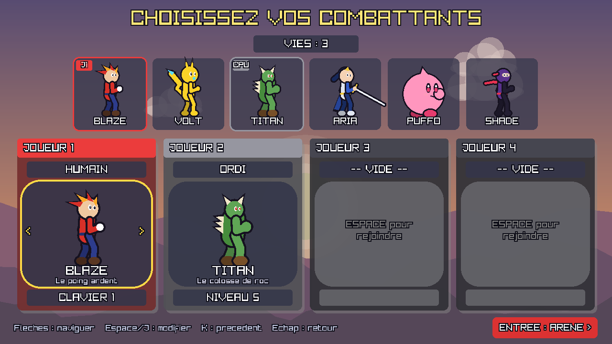
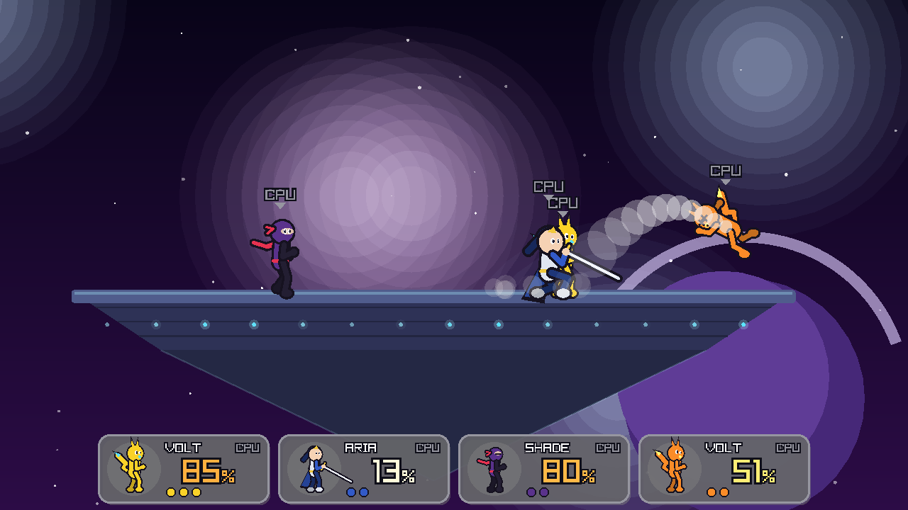
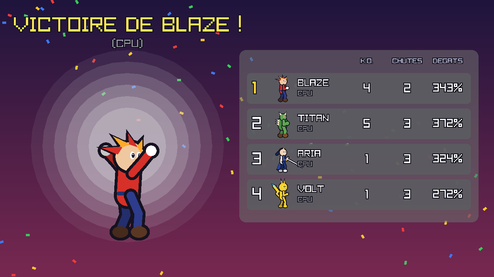

# Super Clash Bros.

Un jeu de combat de plateforme en C++ inspiré de **Super Smash Bros.** : on ne vide pas une barre de vie,
on fait monter le **pourcentage de dégâts** de l'adversaire jusqu'à pouvoir l'**éjecter hors de l'écran**.



Tout est procédural : les personnages sont dessinés et animés par le code (squelette + cinématique inverse),
les sons et la musique sont synthétisés au lancement. Aucun fichier de ressources.

| Écran titre | Sélection des combattants |
|---|---|
|  |  |
| **Destination Finale** | **Résultats** |
|  |  |

## Le jeu

- **6 combattants** avec chacun ses stats (poids, vitesse, gravité, sauts) et ses 4 attaques spéciales :
  | | Style | Spéciales |
  |---|---|---|
  | **BLAZE** | Polyvalent, poings de feu | Boule de feu rebondissante, Poing comète, Uppercut solaire, Tornade |
  | **VOLT** | Rapide et léger | Éclair, Charge foudre (à charger), Zip (dans 8 directions), Tonnerre |
  | **TITAN** | Poids lourd | Poing titan (à charger), Charge bélier (super armure), Forteresse, Séisme |
  | **ARIA** | Épéiste (pointe de l'épée plus forte) | Brise-garde, Lame dansante (3 coups), Envol du dauphin, Contre |
  | **PUFFO** | Flotteur, 5 sauts en l'air | Étoile, Marteau, Tornade étoilée, Pierre (super armure) |
  | **SHADE** | Ninja | 3 Shurikens, Lame éclipse (intangible), Disparition (téléportation), Contre-ombre |
- **Mécaniques à la Smash** : formule de recul de Smash (dépend du %, du poids et des dégâts), arrêt sur
  image à l'impact (*hitlag*), influence directionnelle (*DI*), petits/grands sauts, chute rapide,
  bouclier qui s'use (et se brise !), roulades, esquives au sol et en l'air, saisies + 4 projections,
  rebords (accroche, remontée, attaque, roulade, saut), retombée en culbute + *tech*, chute libre après
  la remontée, attaques smash à charger, super armure, contres, projectiles, plateformes traversables
  et mobiles.
- **3 arènes** : Destination Finale, Champ de Bataille, Îles Célestes (plateforme mobile).
- **1 à 4 joueurs** : humains (2 sur le clavier + manettes) et/ou **ordinateurs de niveau 1 à 9**.
- Effets : étincelles, traînées d'éjection, rayon de K.O., tremblement d'écran, bulles quand un
  combattant est hors-champ, caméra dynamique, compte à rebours, « GAME ! », écran de résultats.

## Contrôles

| Action | Clavier 1 | Clavier 2 | Manette |
|---|---|---|---|
| Se déplacer / viser | `W` `A` `S` `D` | Flèches | Stick gauche / croix |
| Sauter | `Espace` | `Pavé 0` ou `,` | `Y` / `X` |
| Attaque | `J` | `Pavé 1` ou `.` | `A` |
| Spéciale | `K` | `Pavé 2` ou `/` | `B` |
| Bouclier / esquive | `L` | `Pavé 3` ou `Maj droite` | `RB` / gâchettes |
| Saisie | `I` (ou bouclier + attaque) | `Pavé 5` ou `Ctrl droit` | `LB` |
| Attaque smash | `O` (+ direction) | `Pavé 4` ou `;` | Stick droit |
| Pause | `Échap` / `P` | `Échap` / `P` | `Start` |

Les touches sont **physiques** (disposition QWERTY) : sur un clavier AZERTY, le joueur 1 se déplace avec
`Z` `Q` `S` `D`, et la touche smash est la même que `O`.

Combinaisons :
- **Attaque smash** : direction + attaque *en même temps* (ou la touche smash). Maintenir pour charger.
- **Attaques normales (tilts)** : maintenir la direction un court instant, *puis* attaquer.
- **Attaque en course** : courir puis attaquer.
- **Aériennes** : attaque + direction en l'air (avant, arrière, haut, bas, neutre).
- **Spéciales** : spéciale + direction (neutre, côté, haut = remontée, bas).
- **Petit saut** : appui bref sur saut. **Chute rapide** : bas pendant la descente.
- **Bouclier + gauche/droite** = roulade, **bouclier + bas** = esquive, **bouclier en l'air** = esquive aérienne.
- **Saisie puis direction** = projection, **saisie puis attaque** = coup de genou.
- **Bas sur une plateforme fine** = la traverser. Au **rebord** : vers la scène pour remonter, saut,
  attaque ou bouclier.
- Dans les menus : flèches/`WASD`, `Espace`/`J` pour modifier, `K` pour revenir en arrière dans une liste,
  `Entrée` pour valider, `Échap` pour revenir ; la souris marche aussi (clic gauche/droit).
- `M` : couper le son. `F11` : plein écran. `F1` en combat : afficher les hitboxes.

## Compilation

Prérequis : un compilateur C++17, CMake ≥ 3.16. [raylib](https://www.raylib.com/) 5.5 est téléchargée
automatiquement par CMake si elle n'est pas installée.

**Linux** (Debian/Ubuntu) :
```bash
sudo apt install build-essential cmake git libx11-dev libxrandr-dev libxinerama-dev \
                 libxcursor-dev libxi-dev libgl1-mesa-dev libasound2-dev
cmake -S . -B build -DCMAKE_BUILD_TYPE=Release
cmake --build build -j
./build/super_clash
```

**macOS** : `brew install cmake`, puis les trois mêmes commandes `cmake`.

**Windows** : avec Visual Studio 2022 (« Développement Desktop en C++ »), ouvrir le dossier ou :
```bat
cmake -S . -B build
cmake --build build --config Release
build\Release\super_clash.exe
```

### Options de lancement

```
super_clash --demo            # match de démonstration entre 4 ordinateurs
super_clash --stage 2         # arène par défaut (0, 1 ou 2)
super_clash --debug           # hitboxes visibles
super_clash --export-audio d  # écrit tous les sons et musiques en .wav dans le dossier d
```

## Tests

La simulation est indépendante du rendu : elle se compile seule et se teste sans écran.

```bash
cmake -S . -B build-core -DCLASH_BUILD_GAME=OFF
cmake --build build-core -j
./build-core/sim_test
```

Les tests vérifient la formule de recul, les coups, les K.O., chaque commande clavier (petit/grand saut,
smash/tilt, aériennes, bouclier, roulade, saisie, rebord, plateformes), la remontée de chaque personnage
depuis le vide, des dizaines de matchs complets entre ordinateurs, l'équilibrage et le déterminisme.

## Architecture

```
src/core/   simulation pure (aucune dépendance)
  moves.hpp            données : hitboxes, projectiles, attaques, personnages
  roster*.cpp          les 6 combattants et leurs attaques
  stage.cpp            les arènes
  fighter_update.cpp   machine à états des combattants (contrôles)
  fighter_physics.cpp  déplacements, collisions, atterrissages, rebords
  combat.cpp           détection des coups, recul, bouclier, contres, saisies, projectiles
  match.cpp            déroulement du match, K.O., réapparition, fin de partie
  ai.cpp               ordinateur (niveaux 1 à 9)
src/game/   interface raylib
  render_body.cpp      dessin des personnages (squelette + IK)
  render_fighter.cpp   poses : chaque attaque anime le membre qui porte la hitbox
  render_world.cpp     décors, plateformes, projectiles
  render_hud.cpp       pourcentages, vies, bulles hors-champ
  fx.cpp               particules, rayons de K.O., tremblements, sons
  audio.cpp            synthèse des sons et de la musique
  menus.cpp, app.cpp   écrans titre, sélection, arène, résultats
tests/sim_test.cpp     tests sans écran
```

La simulation tourne à 60 images/seconde à pas fixe et est entièrement déterministe.
