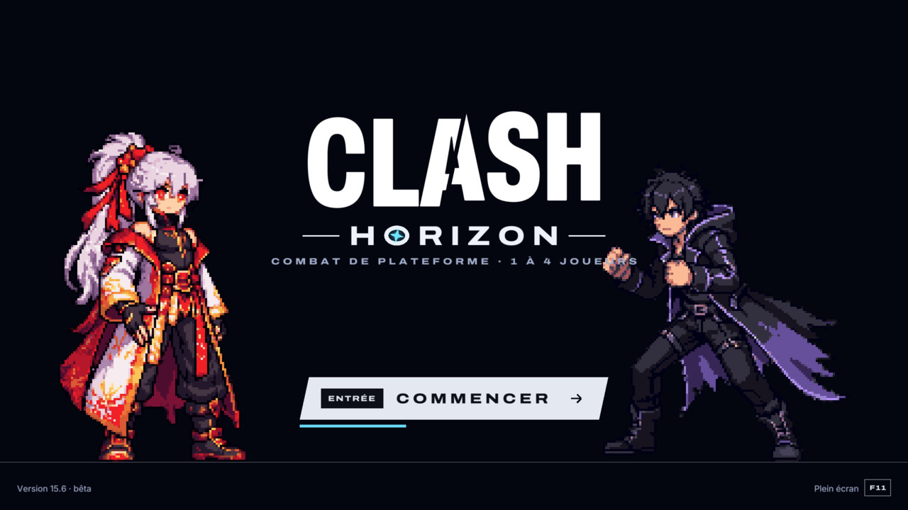
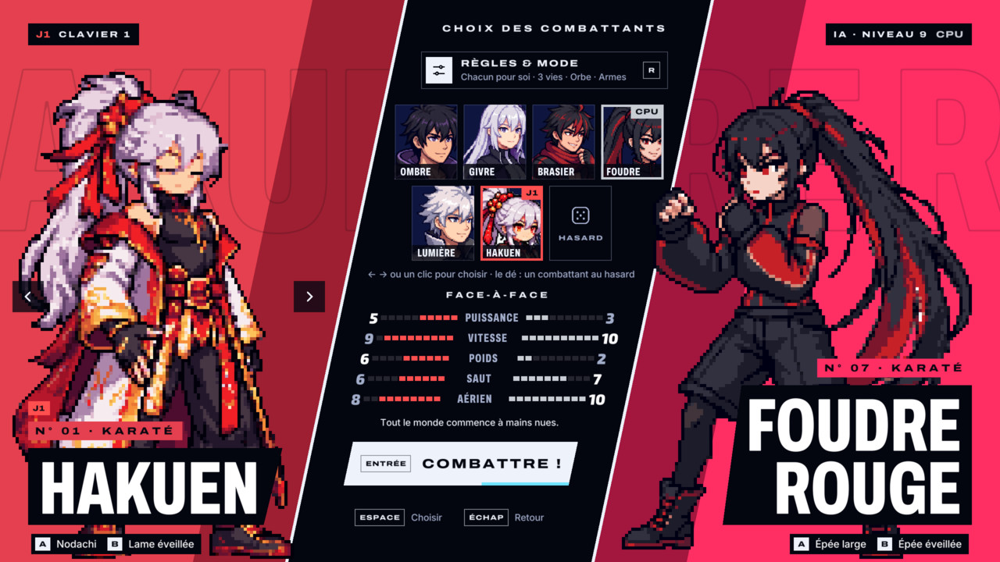
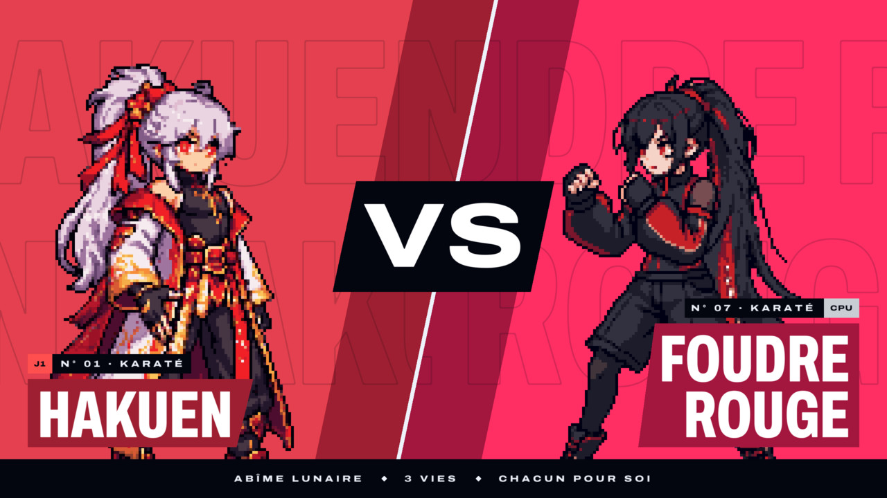
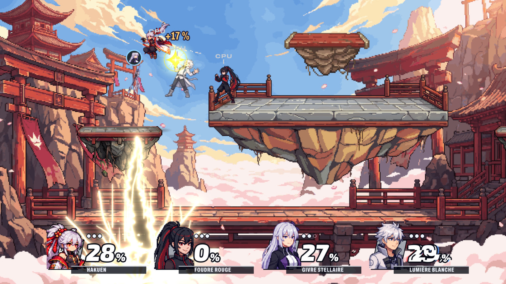
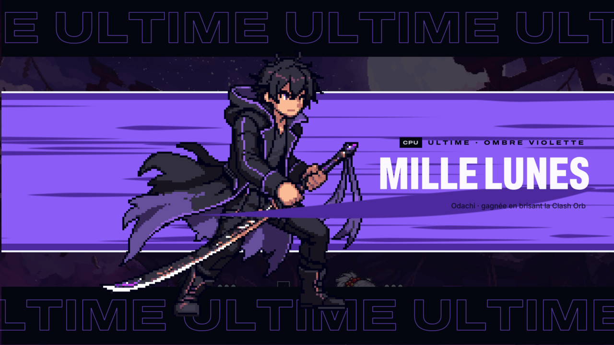
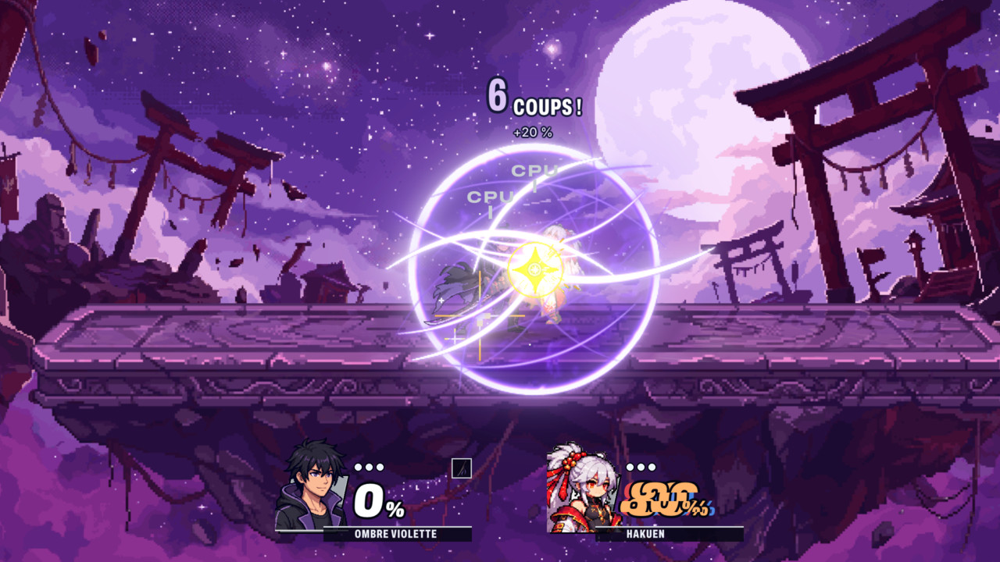
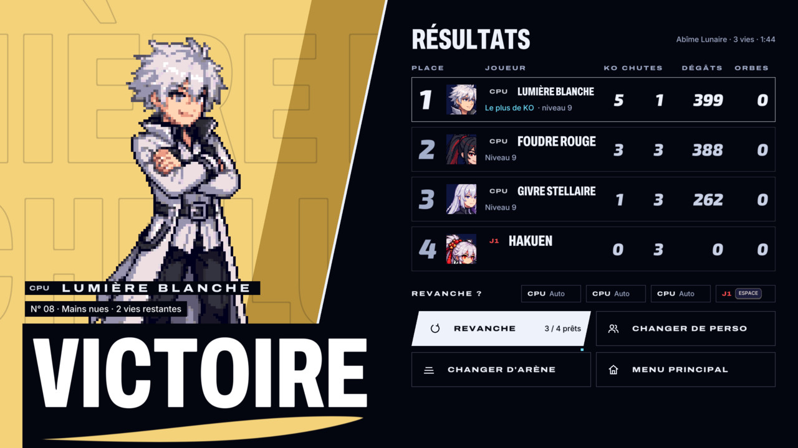

# Clash Horizon

Un jeu de combat de plateforme en pixel art, de 1 à 4 joueurs. On ne vide pas une barre de vie : on fait monter le
pourcentage de dégâts de l'adversaire jusqu'à pouvoir l'éjecter de l'arène.



## Jouer

Version actuelle : **15.8** (bêta). Rien à installer : le jeu tient dans un seul fichier.

- **Windows** :
  [ClashHorizon-windows-x64.zip](https://github.com/grahamyoan9710-tech/test-claude/releases/latest/download/ClashHorizon-windows-x64.zip).
  Décompresser, puis double-cliquer sur `clash_horizon.exe`. Si Windows affiche « Windows a protégé votre
  ordinateur » : « Informations complémentaires », puis « Exécuter quand même ».
- **Linux** (Ubuntu 24.04 ou plus récent) :
  [ClashHorizon-linux-x64.tar.gz](https://github.com/grahamyoan9710-tech/test-claude/releases/latest/download/ClashHorizon-linux-x64.tar.gz).
  Décompresser, puis lancer `./clash_horizon` dans le dossier `ClashHorizon`.

Les nouveautés de chaque version sont sur la page [Releases](https://github.com/grahamyoan9710-tech/test-claude/releases).

## Captures

| Choix des combattants | Avant le combat |
|---|---|
|  |  |
| **Combat à 4 joueurs** | **Ultime : MILLE LUNES** |
|  |  |
| **Les coupes de MILLE LUNES** | **Résultats** |
|  |  |

## Le jeu

- **6 combattants originaux**, chacun avec son art martial à mains nues et ses deux armes : Ombre violette, Givre
  stellaire, Brasier rouge, Foudre rouge, Lumière blanche et Hakuen (en bêta).
- **Les armes** tombent sur l'arène pendant le combat : on prend la sienne en restant dessus et en maintenant la
  touche Arme 1 seconde. Avec les deux, la touche Arme passe de l'une à l'autre.
- **Les techniques** : une par direction (neutre, côté, haut, bas), différentes à mains nues et avec chaque arme.
- **L'ultime** ne vient que de la **Clash Orb** : celui qui la brise peut lancer son ultime.
- **5 arènes** : Abîme Lunaire, Citadelle de Givre, Canyon Écarlate, Toits Kurenai et Monastère des Nuées.
- **Modes** : contre l'ordinateur (niveaux 1 à 10), Versus de 2 à 4 joueurs (chacun pour soi ou en équipes), et
  Entraînement contre un mannequin.
- **Graphismes** : les résolutions de l'écran, vrai plein écran (`F11`), préréglages (Performance à Ultra), lancer
  de rayons, AMD FSR 1, FXAA ou SSAA ×2 ; les menus et les textes restent toujours nets.

## Commandes

Touches par défaut, modifiables dans **Paramètres > Commandes** :

| Action | Clavier 1 | Clavier 2 | Manette |
|---|---|---|---|
| Se déplacer | `Z` `Q` `S` `D` | Flèches | Stick gauche ou croix |
| Sauter | `Espace` | `;` | `X` |
| Attaque | `J` | `:` | `B` |
| Spéciale | `K` | `!` | `A` |
| Bouclier | `L` | `Maj droite` | `LT` / `RT` |
| Saisie | `I` | `Ctrl droit` | `LB` / `RB` |
| Attaque smash | `O` | `M` | Stick droit |
| Ultime | `U` | `ù` | `Back` |
| Arme | `E` | `,` | `Y` |
| Pause | `Échap` | `Échap` | `Start` |

Les touches sont celles d'un clavier AZERTY ; le jeu affiche les vraies touches de votre clavier. Les manettes sont
reconnues toutes seules (Xbox, PS4, PS5) : Paramètres > Commandes dessine la vôtre, chaque bouton relié à son action.
Sur une manette PlayStation ou Switch, les boutons sont aux mêmes places que sur la manette Xbox ci-dessus.

## Compiler

Il faut un compilateur C++17 et CMake 3.16 ou plus ; [raylib](https://www.raylib.com/) 5.5 est téléchargée par
CMake.

```bash
# Linux (Debian/Ubuntu)
sudo apt install build-essential cmake git libx11-dev libxrandr-dev libxinerama-dev libxcursor-dev libxi-dev \
  libgl1-mesa-dev
cmake -S . -B build -DCMAKE_BUILD_TYPE=Release
cmake --build build -j
./build/super_clash
```

- **Windows** (Visual Studio 2022) : `cmake -S . -B build`, `cmake --build build --config Release`, puis
  `build\Release\super_clash.exe`.
- **Tests** de la simulation, sans écran : `cmake -S . -B build-core -DCLASH_BUILD_GAME=OFF`,
  `cmake --build build-core -j`, puis `./build-core/sim_test`.
- **Archives** Linux et Windows : `scripts/package_release.sh 15.8` (dans `dist/`).

## Crédits

- Combattants et armes en pixel art générés avec PixelLab ; effets faits dans Blender ; bruitages générés avec
  ElevenLabs.
- Polices Archivo, Inter et Exo 2 : SIL Open Font License 1.1 (`assets/fonts/`).
- Base de manettes SDL_GameControllerDB : licence zlib (`assets/gamecontrollerdb-LICENSE.txt`).
